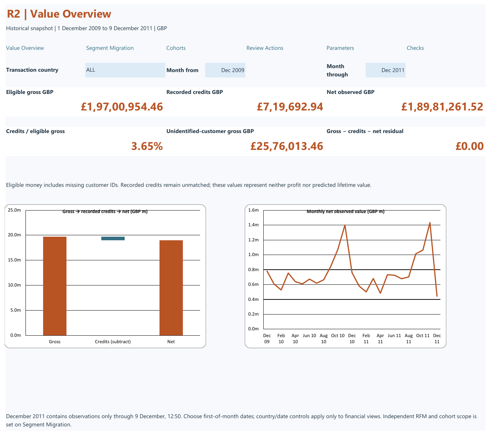
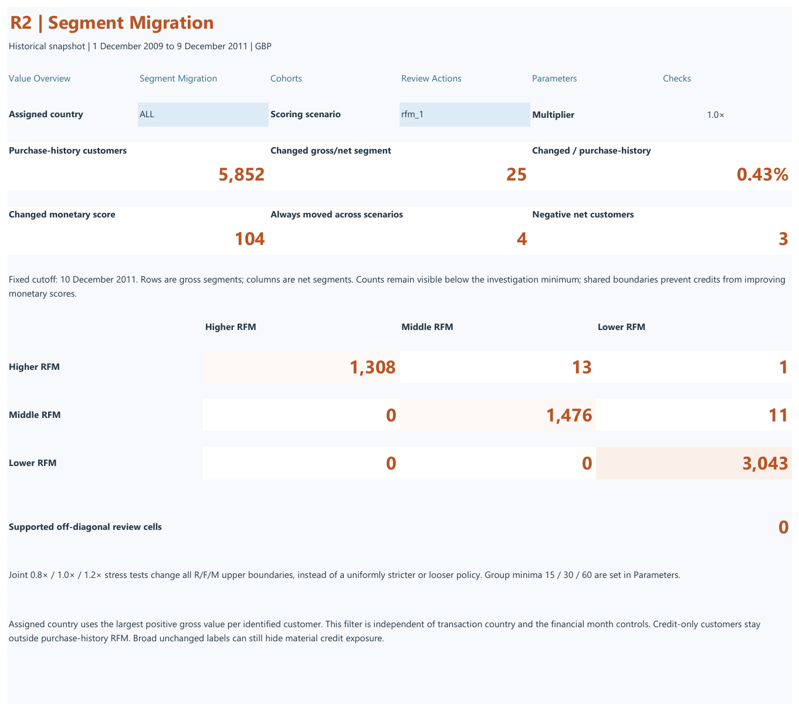
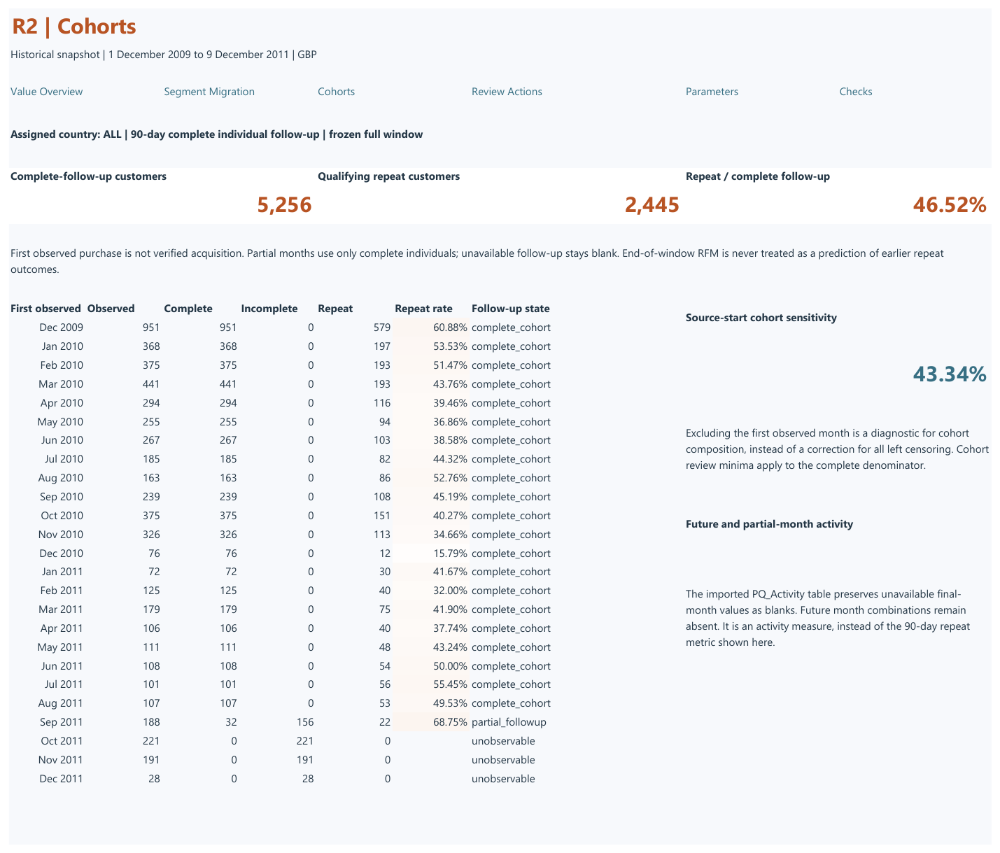
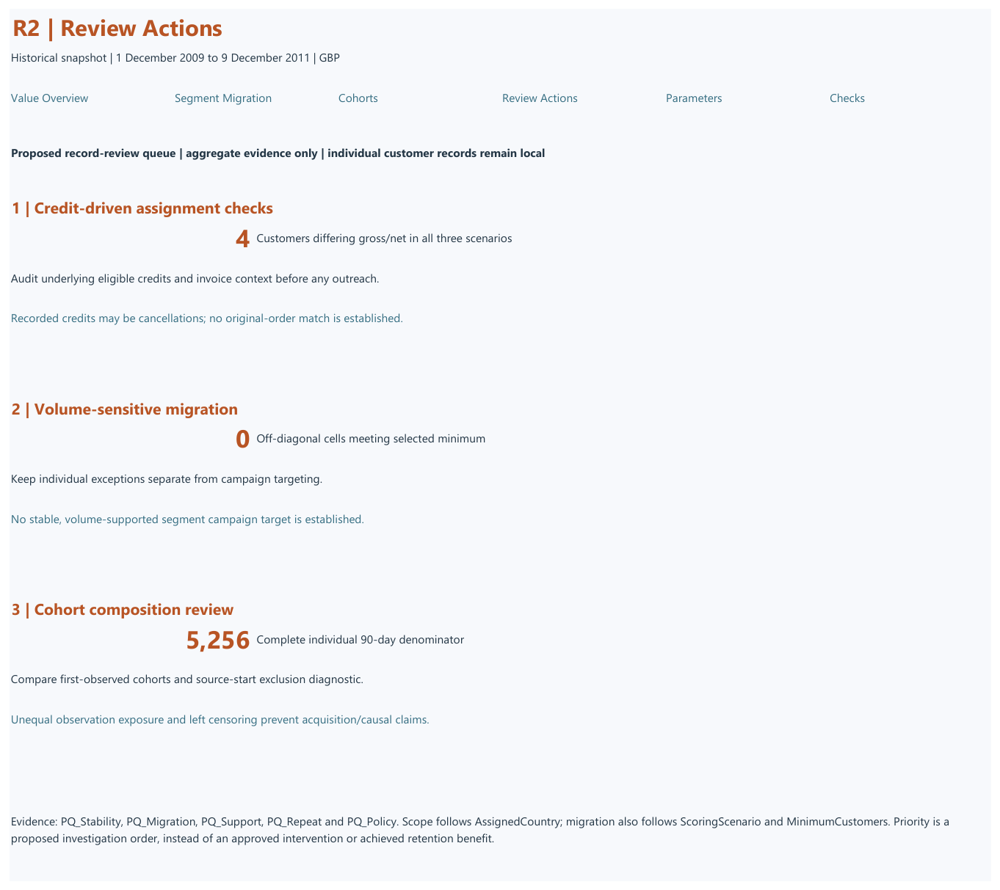

# Returns-Adjusted Customer Value

A historical retail analysis of how recorded credits affect customer value, RFM segments and repeat-purchase measures. The project uses Python, SQL and Excel to reconcile transactions and assess whether segment changes support a customer review.

**Status:** Complete  
**Data:** UCI Online Retail II  
**Tools:** Python, SQL, Excel

## Key findings

At the 10 December 2011 cutoff, recorded credits changed the broad RFM segment for **25 of 5,852** identified customers with purchase history (0.43%). Across three tested threshold scenarios, 18 to 27 customers changed segment. Monetary scores changed for 104 customers even when broad segment labels often remained the same.

No changed-segment cell met the base minimum of 30 customers. The recommended next step is to review individual credit records, starting with the four customers whose gross and net segments differed in all three scenarios, rather than use the small groups as campaign targets. See the [findings and decision memo](docs/findings.md) and [threshold evidence](outputs/full_threshold_summary.csv).

## Workbook

The [Excel workbook](reports/excel/R2_review_v4.xlsx) contains four views: Value Overview, Segment Migration, Cohorts and Review Actions. It uses Power Query, PivotTables and formulas to support financial reconciliation and customer analysis.

These previews are printed Excel renders. Setup and controls are described in the [workbook guide](reports/excel/README.md).

## Approach

- Verified the supplied workbook against the official source and addressed overlapping coverage between its two worksheets.
- Classified merchandise, credits and exceptions, then reconciled gross, credits and net values. Eligible transactions without customer IDs remain in financial totals.
- Compared gross and net RFM assignments using shared, frozen thresholds and tested threshold sensitivity.
- Measured repeat activity only for cohorts with complete follow-up; reported cohort composition alongside repeat rates.

See the [analysis methods](docs/analysis_methods.md), [metric dictionary](docs/metric_dictionary.md) and [data manifest](docs/data_manifest.md) for definitions and source details.

## Reproduce and validate

Follow the [environment guide](docs/environment.md) to obtain the source, install dependencies and run the pipeline. The [workbook guide](reports/excel/README.md) covers Excel setup and refresh. Raw data and local databases are excluded from version control.

The analysis was checked against independent calculations, and the workbook received native Excel refresh, formula and control checks. The [validation record](docs/validation.md) and [technical evidence](docs/technical_evidence.md) document the tests and their scope.

## Limitations

- Recorded credits are not confirmed physical returns and are not matched to original invoices.
- RFM analysis excludes customers without identified purchase history, while financial totals retain eligible unidentified transactions.
- Repeat rates are descriptive and depend on observable follow-up and cohort composition; they do not measure retention lift or predicted lifetime value.

Source attribution and licensing are recorded in the [data manifest](docs/data_manifest.md).
